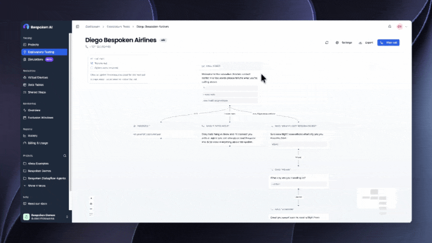
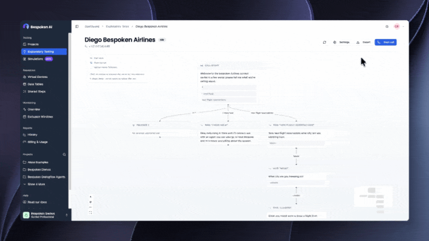

Understanding all the possible paths through an IVR can take time. You need to navigate the system, try different options, and document each path before you can start building automated tests.

**Exploratory Testing lets you discover IVR call flows visually and turn them into automated test cases, all in one place.**

## Explore IVR call flows visually

Start an exploratory test and interact with your IVR as you normally would. Bespoken automatically builds a visual representation of the call flow as you navigate it.

Each option you explore adds new nodes and branches to the flow, helping you understand the different paths customers can take through your system.

You can navigate the visualization, zoom in and out, select nodes, and edit the flow to refine or expand your exploration.

## Generate automated test cases

Once you've explored your IVR, export the flow to generate automated test cases directly in your Bespoken dashboard.

Each discovered path becomes a starting point for a test case, so you can move from exploring your IVR to testing its behavior without manually rebuilding the flows.

## Build on your exploration

Your generated test cases are available in the dashboard, where you can review and continue working with them.

Whether you're discovering new call paths or documenting an existing IVR, Exploratory Testing makes it easier to turn what you find into repeatable automated tests.

**Exploratory Testing is now officially available in Bespoken AI.**