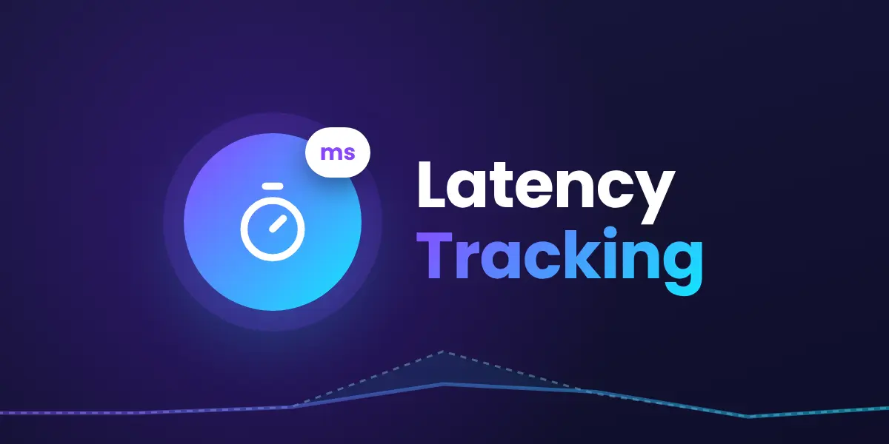
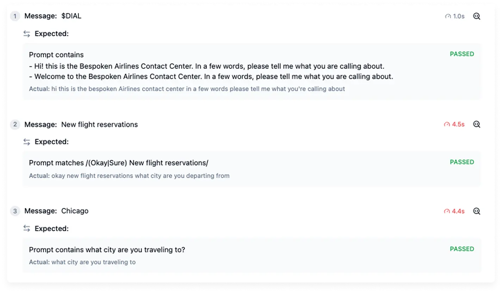
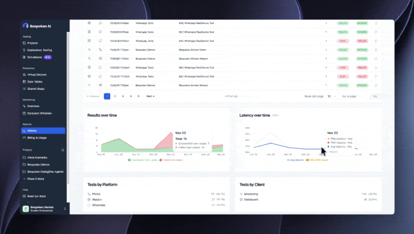

Knowing whether your IVR or conversational system works as expected is important, but knowing how quickly it responds matters too. Slow responses can affect the customer experience, and identifying where they happen isn't always easy.

**Bespoken now gives you more ways to measure, monitor, and evaluate latency across your automated tests.**

## Measure latency across test steps

Test results now show latency for individual steps, along with average latency for an individual call and an entire test suite.

This makes it easier to identify which steps are taking longer to respond and understand performance across your automated tests.

## Track latency over time

The **History** view now includes a **Latency Over Time** chart to help you monitor response times across different days.

The chart displays average latency and the P90–P95 range, making it easier to spot potential slowdowns, identify performance trends, and investigate changes over time.

## Set latency thresholds for test evaluation

You can now use latency as an evaluation criterion for individual test steps.

Set a response-time threshold and Bespoken will flag any steps that exceed it. This means your automated tests can evaluate not only whether a flow works as expected, but also whether it responds within your defined time limits.

**With these improvements, you can keep a closer eye on response times and make sure your conversational systems perform within your expectations.**

