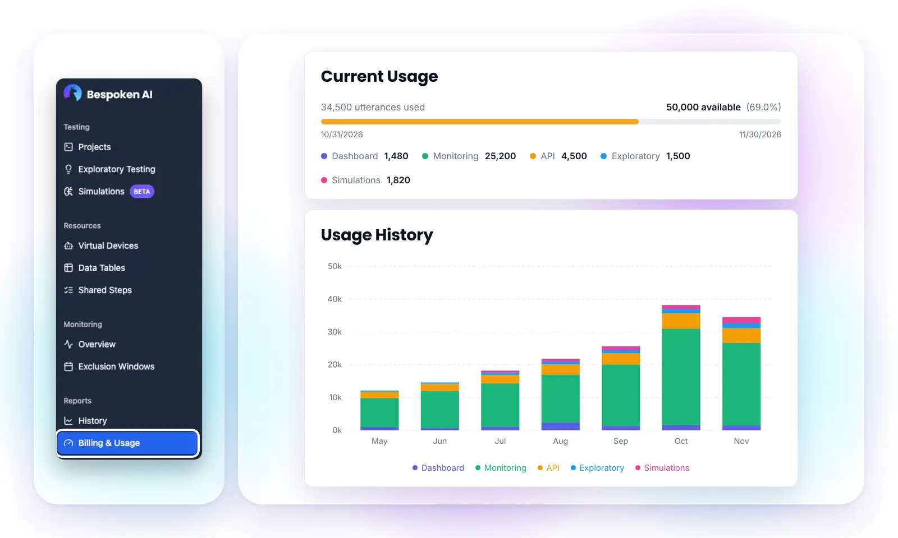

Understanding how many utterances your team consumes is useful, but knowing where that usage comes from gives you a much clearer picture.

**The new Usage Breakdown gives you a more detailed view of how your team consumes utterances across different Bespoken features.**

## See usage by feature

The Usage chart now breaks down utterance consumption by feature, so you can see how much usage comes from:

- **Monitoring**
- **Dashboard**
- **API**
- **Exploratory**
- **Simulations**

Each feature has its own color in the chart, making it easier to distinguish where your utterances are being consumed.

## Understand your team's usage

With this breakdown, you can get a better understanding of how your team uses Bespoken and which features account for the most utterance consumption.

Instead of looking at a single total, you can identify usage patterns and see where you might need to make adjustments.

## Find it in your dashboard

You can access the updated chart under **Billing & Usage** in the left-hand navigation menu.

**More visibility into your usage means better insight into how your team uses Bespoken.**
