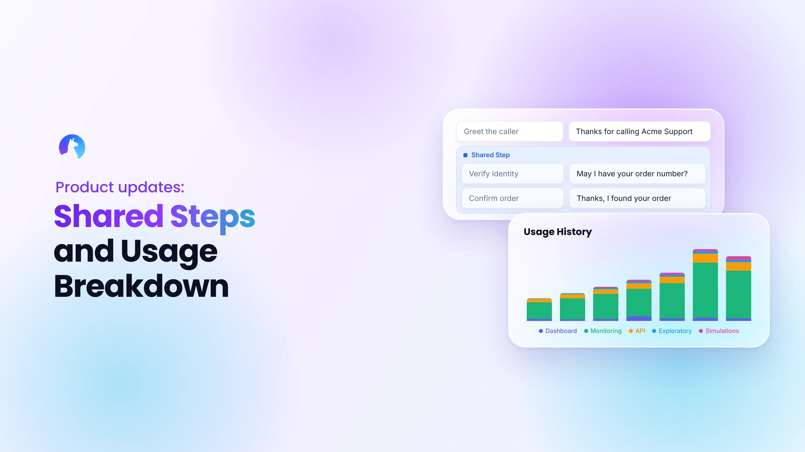
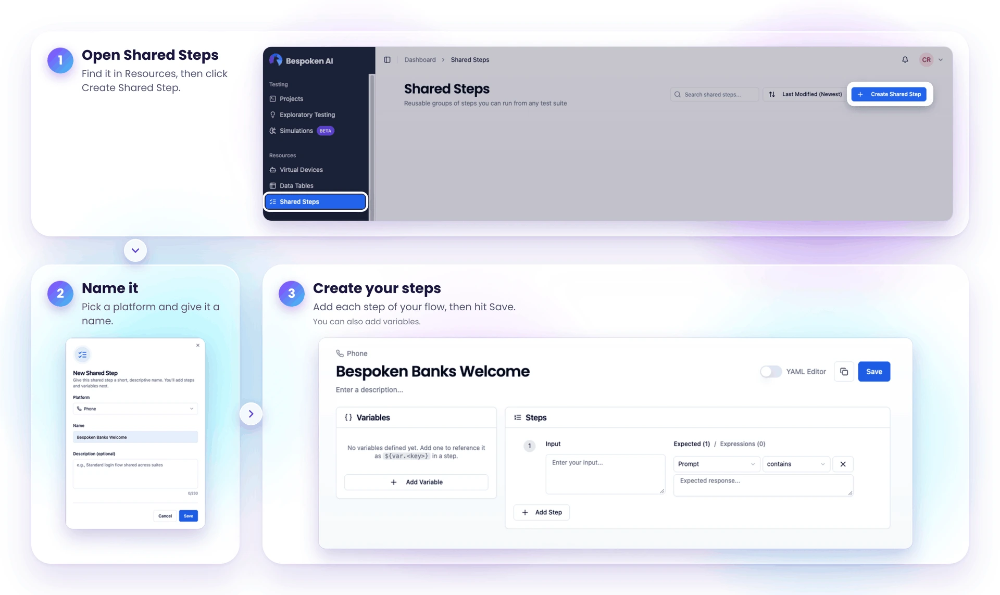
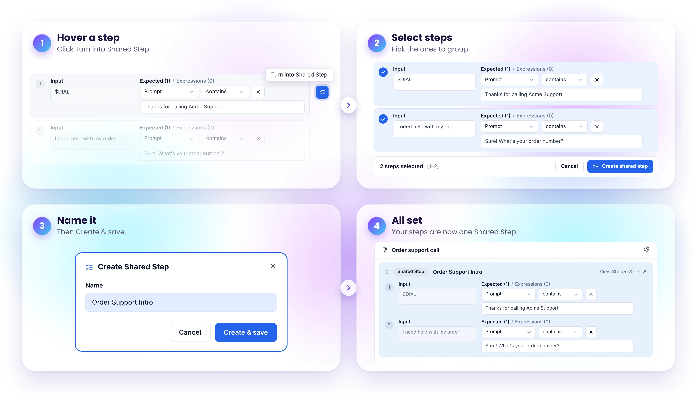
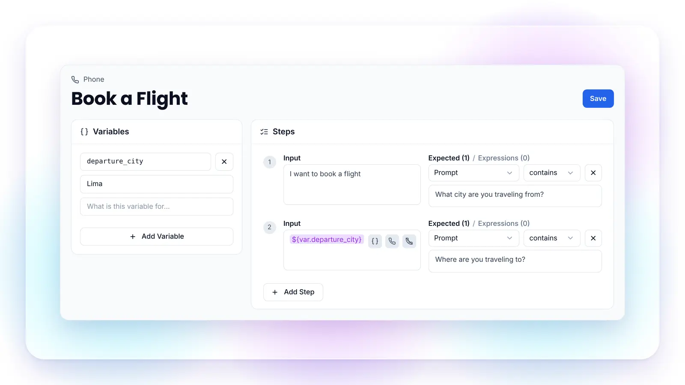

Many test cases share the same conversation steps. A welcome message, an account verification, or a series of questions might appear in dozens of tests, even when the conversations take different directions afterward.

Maintaining all those copies takes time. And when something changes, you have to update each test individually.

**Shared Steps let you create a conversation flow once and reuse it across multiple test cases. Update it in one place, and every test using it automatically gets the changes.**

## Create Shared Steps from scratch or from existing tests

There are two ways to create a Shared Step.

You can start from scratch by opening **Shared Steps** in the sidebar and selecting **Create Shared Step**. Give it a name, choose the platform, add an optional description, and build your conversation flow using inputs and expected responses.

Or, you can turn existing test steps into a Shared Step. Select the adjacent steps you want to group together and click **Turn into Shared Step**. Bespoken can also identify other test cases containing those same steps, so you can review them and choose to replace them with the new Shared Step.

## Reuse and update flows across tests

Once created, you can insert a Shared Step into multiple test cases.

You can open a Shared Step directly from a test case to make changes, or find it in the Shared Steps section of the sidebar, where you can browse your full library.

Make an update once, and it automatically applies to every test case using that Shared Step. You can also see which test cases use each Shared Step, making it easier to understand where a flow is being reused.

## Use variables for different scenarios

Shared Steps support variables, allowing you to reuse the same conversation flow with different values across test cases.

For example, instead of hardcoding a city name in a conversation, you can use a variable like $[var.departure_city] and assign different values in each test case.

You can also populate variables from a data table, making it easier to test multiple scenarios without duplicating the conversation flow.

## Keep your test cases in sync

Shared Steps give you one place to manage the conversation steps your tests have in common. No more manually updating the same flow across multiple test cases.

**Write a flow once. Reuse it everywhere.**